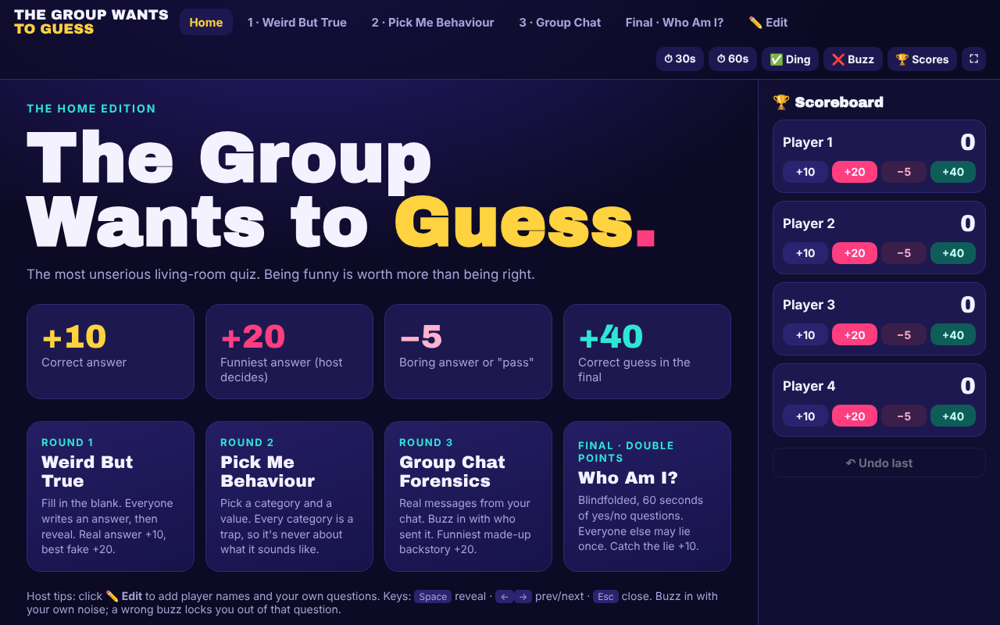

# The Group Wants to Guess

A living-room party quiz made for a TV or a projector. Four rounds, a scoreboard, timers and sound effects, and every question is editable. Being funny is worth more than being right.

**Live:** https://vishwadeep-solves-conflicts.github.io/group-wants-to-guess/



## The rounds

1. **Weird But True:** fill in the blank. The real answer gets +10, and the best fake answer gets +20.
2. **Pick Me Behaviour:** a quiz board where every category is a misdirect ("Java" is the island, "Mercury" is Freddie).
3. **Group Chat Forensics:** real messages from your group chat. Guess who sent them.
4. **Final, Who Am I?:** blindfolded yes/no questions for 60 seconds. Everyone else may lie once.

## Hosting a game

- Open **✏️ Edit** to add player names and your own questions. A line like `question | answer` is all it takes.
- **Keys:** <kbd>Space</kbd> reveals, <kbd>←</kbd> <kbd>→</kbd> step through questions, <kbd>Esc</kbd> closes.
- The toolbar has 30 s and 60 s timers, ding and buzz sounds, the scoreboard (with undo), and fullscreen.
- Round 3 starts with sample messages. Paste real ones before the game, and check with your friends before using anything embarrassing.

Everything stays in your browser's local storage. There's no server, account or tracking.

## Run it locally

You need Node 20 or newer.

```bash
npm install
npm run dev      # http://localhost:5173
npm run build    # production build in dist/
```

## Where things are

```
src/
  data/defaults.ts     the questions a new game starts with (edit them here)
  views/               one file per screen: Home, the four rounds, Edit
  components/          header, scoreboard, board question pop-up, timer, toast
  hooks/
    useGame.ts         the saved game: questions, scores, used tiles, undo
    useTimer.ts        the 30 s / 60 s countdown
  lib/
    storage.ts         saving to local storage
    sound.ts           ding, buzz, reveal and tick sounds
    editText.ts        the "question | answer" text format on the Edit screen
  styles/
    theme.css          the game's colours for each theme
    app.css            layout and components
  shared/              theme switcher and top bar, the same in every app
  App.tsx              which screen is showing, keyboard shortcuts
```

Saved games from the old single-file version still load, because the storage key hasn't changed.

## Deploying

Every push to `main` runs `.github/workflows/deploy.yml`, which builds the app and publishes `dist/` to the `gh-pages` branch. GitHub Pages serves that branch, and the self-hosted server copies it.

## Licence

MIT. Built by [Vishwadeep Kushwaha](https://vishwadeep-s.netlify.app).
